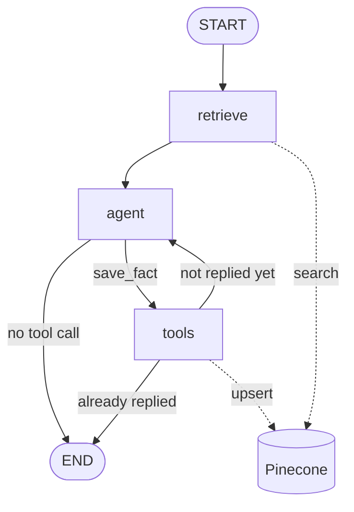

# Vector Database Tutorial with Pinecone

A chat agent with long-term memory. It saves facts you tell it in a hosted Pinecone vector index and retrieves them in later conversations.

The agent is a [LangGraph](https://docs.langchain.com/oss/javascript/langgraph/overview) graph in [lib/graph.js](./lib/graph.js):



- **retrieve** searches Pinecone for facts similar to the latest message on every turn.
- **agent** calls the chat model with those facts in the system prompt ([SYSTEM_PROMPT.md](./SYSTEM_PROMPT.md)).
- **tools** runs `save_fact` when the model decides the user shared something worth remembering. Some models, such as Gemma, reply in the same turn as the tool call, so the graph ends there. Others reply after seeing the tool result, so the graph returns to **agent**.

Reading is a fixed step, so retrieval always happens. Writing is a tool call, so the model decides what to store. The tool is an ordinary LangChain tool that calls the Pinecone SDK; it needs no MCP server.

Pinecone embeds the fact text itself with [text-embedding-3-small](https://developers.openai.com/api/docs/models/text-embedding-3-small), so the app never handles vectors. [Pinecone integrated embedding documentation](https://docs.pinecone.io/guides/index-data/indexing-overview)

## Pinecone setup

Create a project and API key in the [Pinecone console](https://app.pinecone.io/). On the first request the app creates a serverless index named `vector` if it does not exist, and stores facts in its `facts` namespace.

Each fact's ID is a hash of its text, so saving the same fact twice keeps one copy. Pinecone applies writes asynchronously, so a fact may take a moment to become searchable after it is saved. [Pinecone upsert documentation](https://docs.pinecone.io/guides/index-data/upsert-data)

## Chat model

Open LM Studio, download a chat model, and start the local server on port `1234` from the Developer tab. [LM Studio server setup](https://lmstudio.ai/docs/developer/rest/quickstart)

The model must support tool calling, or it will answer without saving anything. The example settings use `google/gemma-3-12b`. Any other OpenAI-compatible server works too.

## Running

Install Node.js 22 or later, then install the dependencies from the repository root.

```sh
npm install
```

Copy the example environment file and fill in your Pinecone key, plus the OpenAI-compatible server you want to call. Set `OPENAI_MODEL` to the model identifier shown in LM Studio.

```sh
cp .env.example .env.local
```

Start the app.

```sh
npm run dev
```

Open [http://localhost:3000](http://localhost:3000) and tell the agent something about yourself, such as `My dog is named Rex`. A `Remembered:` line shows each fact it saves. Start a new chat and ask `What is my dog's name?` to see it retrieved.
